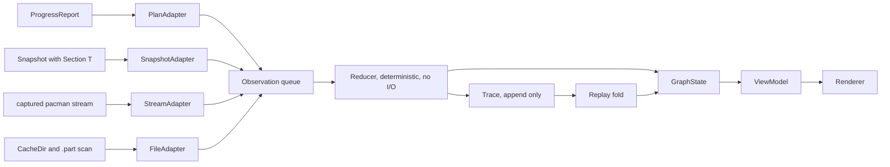
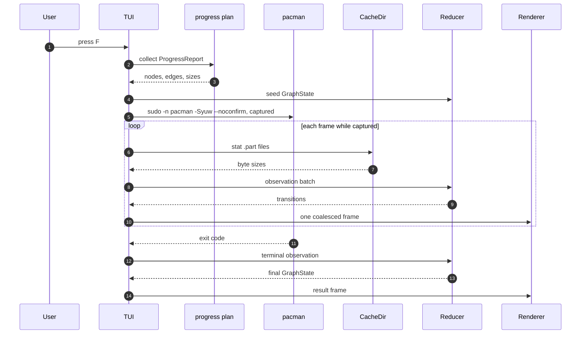

# ANIMATION.md: the DAG execution frontier

Status: design note. The pure frontier reducer is implemented in
[`src/frontier.rs`](../src/frontier.rs) and the pure live view in
[`src/tui/live.rs`](../src/tui/live.rs); the real cache observation source is
[`src/fetch_source.rs`](../src/fetch_source.rs). T2e wires it into
[`src/tui/fetch_session.rs`](../src/tui/fetch_session.rs): `F` runs the real
`fetch` command on a worker and the UI polls the cache every 100 ms. The
monitor itself adds no command, no write path, and no network call. Read with
[`TUI.md`](TUI.md), [`PROGRESS.md`](PROGRESS.md) and [`NEXT.md`](NEXT.md), which
wins on order.

## 1. The graph

A run is `G = (V, E, pi)`.

- `V` is finite. One node per package to be made present, with
  `kind in {official, aur, external}`. External nodes are installed-only
  dependencies, kept in `V` so readiness has one rule.
- `E` is a subset of `V x V`. Edge `(d, p)` means `p` requires `d` first. Edges
  point in execution order, dependency to dependent, so
  `in(p) = { d | (d, p) in E }` is the prerequisite set of `p`.
- `pi` maps a dependency name to providers, section 4.

An edge is `(d, p, k, c, req)`: `k` in {runtime, build, check, provide}, `c` a
version range or any, `req` true when the edge gates readiness. `req = false` is
an unknown edge: displayed, never a gate.

## 2. States and sets

| state | meaning | counts as |
|---|---|---|
| pending | prerequisites not all satisfied | waiting |
| ready | prerequisites satisfied, not started | frontier |
| running | an observation says work started | in flight |
| done | an observation proves the artifact exists | completed |
| failed | an observation proves a terminal error here | blocking |
| skipped | no work needed or excluded, carries `satisfied` | both |
| blocked | a required prerequisite is failed, excluded, blocked | blocking |

`satisfied(v)` is `done`, or `skipped` with `satisfied = true`.
`blocking(v)` is `failed`, `blocked`, or `skipped` with `satisfied = false`.

```text
Ready_t = {v | state_t(v) = ready}    Running_t = {v | state_t(v) = running}
Done_t  = {v | state_t(v) = done}     Frontier_t = Ready_t
Completed_t = Done_t union {v | skipped and satisfied(v)}
Terminal_t  = Completed_t union {v | blocking(v)}
```

The seven states partition `V`. A node is in exactly one set at every `t`.

## 3. Transitions

An observation is `(seq, at, node, kind, evidence)`. `seq` is assigned by the
reducer, monotonic, no gaps. `evidence` is the smallest proof: exit code, cache
filename, `.part` size, `pacman.log` line, section timestamp.

`delta` maps `GraphState` and one observation to `GraphState` plus a transition
batch. The batch includes the observed node's change and any readiness or
blocked changes it releases; every transition in the batch carries the same
`seq`.

| from | observation | to |
|---|---|---|
| pending | every required incoming edge satisfied | ready |
| pending | a required edge becomes unknown | pending, reason shown |
| pending, ready | `excluded` | skipped, satisfied = false |
| pending, ready | `no_work_needed` | skipped, satisfied = true |
| pending, ready | `prerequisite_blocked` | blocked |
| ready | `started` | running |
| running | `finished` | done |
| running | `errored(code)` | failed |

Terminal states are absorbing inside a run. A retry is a new run with a new
trace. A non-matching observation is recorded and ignored, never coerced.

## 4. Readiness

`p` is ready at `t` exactly when:

```text
state_t(p) = pending
and every edge (d, p, k, c, true) has satisfied_t(d) and version_ok(d, c)
and no edge (d, p, k, c, true) has blocking_t(d)
```

A required failure, block, or unsatisfied skip puts `p` in `blocked`. Blocking
closes transitively over dependents, one hop per batch.

**Providers.** `pi(name)` comes from local metadata only: `pacman -Si` and
`-Qui` (`Provides`), `.SRCINFO`, `.PKGINFO`. Empty `pi` because metadata is
absent makes an unknown edge, never a gate. With several providers the first
satisfied one wins, and its id is pinned in the observation so replay cannot
choose differently. A changed provider set is a new observation, never memoized.

**Versions.** `version_ok` compares the pinned provider's available version,
epoch stripped as in `TUI.md`. Unknown version makes the edge unknown. A known
violation makes the dependent `blocked` with `version conflict`, never `failed`,
because nothing executed.

**Unknown edges.** `req = false`. They render `?`, never satisfy readiness and
never block it. Known required edges alone decide.

**Blocked propagation.**

| upstream | required | downstream |
|---|---|---|
| failed | yes | blocked |
| failed | no | unchanged |
| skipped, satisfied | yes | may become ready |
| skipped, not satisfied | yes | blocked |
| blocked | yes | blocked |
| unknown | no | unchanged, displays `?` |

## 5. Parallel fronts

The ready set is a frontier, not a list. Render order is stable and name-sorted,
but it is not execution order. A table step is one coalesced frame, so two
observations may land together. The reducer itself folds one observation at a
time; the adapter may coalesce a frame's observations before the renderer draws.

### Diamond: base, left, right, join

```text
base -> left
base -> right
left -> join
right -> join
```

| step | observation | pending | ready | running | done |
|---|---|---|---|---|---|
| 0 | plan | left, right, join | base | none | none |
| 1 | started base | left, right, join | none | base | none |
| 2 | finished base | join | left, right | none | base |
| 3 | started left | join | right | left | base |
| 4 | finished left, started right | join | none | right | base, left |
| 5 | finished right | none | join | none | base, left, right |
| 6 | started join | none | none | join | base, left, right |
| 7 | finished join | none | none | none | all four |

Step 2 is the only widening: one node to two, then back to one at the join.
`join` cannot leave pending until both required edges are satisfied, and step 4
shows that finishing one branch does not touch the other.

### Two independent roots

```text
root-a -> child-a
root-b -> child-b
```

| step | observation | pending | ready | running | done |
|---|---|---|---|---|---|
| 0 | plan | child-a, child-b | root-a, root-b | none | none |
| 1 | started root-a | child-a, child-b | root-b | root-a | none |
| 2 | started root-b | child-a, child-b | none | root-a, root-b | none |
| 3 | finished root-a, started child-a | child-b | none | root-b, child-a | root-a |
| 4 | finished root-b, started child-b | none | none | child-a, child-b | root-a, root-b |
| 5 | finished child-a | none | none | child-b | root-a, root-b, child-a |
| 6 | finished child-b | none | none | none | all four |

Step 3 is the point: one branch releases its child while the other is still
running. The frontier is a set of enables, and no view may serialize it into a
queue.

## 6. Plan, trace, result

| view | input | states it may show |
|---|---|---|
| plan | `ProgressReport`, cache scan, state file | pending, ready, skipped |
| trace | append-only observations | every state |
| result | fold of the trace | every state |

The plan predicts. It never shows running, done, or failed. A `cached` badge is
a skipped-satisfied node with cache evidence.

The trace is `[(seq, at, node, kind, evidence)]`, append only, in memory, capped,
never on disk in v1. Overflow drops the oldest entry and increments `dropped`;
the view shows `events dropped: N`. A replay that needs a dropped entry refuses
rather than guessing. Replay is the same fold stopped at `k`:

```text
R = fold(reduce, GraphState::seed(plan), trace)
```

Determinism needs sequence order, pinned providers, and no wall clock in
`reduce`. The renderer reads `at` from observations, never `now`.

**The attached install is replay-only.** While `yay` owns the terminal the TUI
is suspended and emits no observations. On return one batch is appended: exit
code, post-install probes, and the `pacman.log` delta. Plan before, result
after. This is required, not a gap: D3 keeps PKGBUILD review, and `yay` passes
`makepkg` output through without a prefix, so a captured stream could not
attribute a phase to a package.

## 7. Rendering rules

1. **Animate only on a real transition.** The reducer's transition batch is the
   only redraw trigger. A tick may advance an elapsed label for a running node,
   but no glyph, row, bar or tree line moves on a timer.
2. **No synthetic percentage.** pacman suppresses progress when stdout is not a
   TTY. Live bytes come from `.part` growth, polled with `stat`. A percentage
   needs both observed bytes and a known total. `PROGRESS.md` and `TUI.md` use
   the same rule: `.part` growth is authoritative and no progress bar is parsed.
3. **Freeze on failure.** The first failed transition sets `frozen`. Motion and
   byte polling stop globally, the failed node and its blocked dependents
   stay visible, and the repair card replaces the footer.
4. **Coalesce.** Observations may outrun frames. The reducer folds the queue
   into one state and one transition batch per frame. The renderer draws the
   final state and logs intermediate events. Coalescing is lossless for state
   and lossy for intermediate glyphs by design. A bounded queue drops nothing
   silently: overflow shows `events dropped: N`.
5. **10 to 15 fps only while a captured task runs.** Frame budget is 66 to 100
   ms. There is no idle tick. The 60s fast refresh is a scheduled wake, not
   animation (`TUI.md` T8). `--no-motion` removes the pulse and byte cadence and
   keeps glyphs, counters and timers.

## 8. Rust seam

```rust
pub trait Source { type Fact; fn poll(&mut self) -> Vec<Self::Fact>; }
pub trait Adapter<F> { fn adapt(&self, fact: F) -> Vec<Observation>; }
pub trait Renderer { fn draw(&mut self, vm: &ViewModel, out: &mut Frame) -> Result<(), Error>; }

pub struct Observation { pub seq: u64, pub at: Instant, pub node: NodeId,
                         pub kind: Observed, pub evidence: Evidence }
pub enum Observed { EdgeResolved, Started, Finished, Failed, Excluded, NoWork }

pub fn reduce(state: &mut GraphState, obs: &Observation) -> Vec<Transition>;

pub struct Transition { pub seq: u64, pub node: NodeId,
                        pub from: NodeState, pub to: NodeState }

pub struct GraphState { pub nodes: BTreeMap<NodeId, NodeState>, pub edges: Vec<Edge>,
                        pub ready: BTreeSet<NodeId>, pub running: BTreeSet<NodeId>,
                        pub done: BTreeSet<NodeId>, pub frozen: bool, pub last_seq: u64 }
pub struct ViewModel { pub rows: Vec<Row>, pub counters: Counts, pub frozen: bool,
                       pub provenance: Vec<SectionAge> }
```

The layers, one direction only:

- **Source**: `ProgressReport`, `Snapshot` sections, the captured fetch stream,
  the CacheDir `.part` scan, the `pacman.log` tail.
- **Adapter**: turns a domain fact into observations. It owns sanitization and
  never guesses. A line that cannot be attributed produces no observation.
- **Reducer**: deterministic, no I/O. Folds observations, appends the trace,
  maintains the sets, returns transitions.
- **GraphState**: the only mutable model state. Counts derive from it.
- **ViewModel**: rows and counters from `GraphState` plus section ages. No
  collection, no I/O.
- **Renderer**: draws the view.

How the report layer feeds it:

- The T2 `ProgressReport` seeds node ids, edges, expected sizes, and the initial
  pending or ready assignment. `FetchPlan` remains the fetch action's plan, not
  the graph. Neither seeds dynamic state.
- `Snapshot` is the static read path. `Section<T>` is a fact or a provenance
  record. `Ready { data, at }` yields facts stamped `at`.
  `Failed { error, at }` freezes the affected subtree and renders the message.
  `NotCollected` renders unknown and yields no observation.
- Nothing in `Snapshot` anchors the run: the fetch session streams the child's
  lines and `FetchMonitor` owns `running`, and an adapter turns an observed
  change into a transition. Lines go to the log, not to the tree.
- `Snapshot` never drives motion. An old section renders dim and old. Age is
  data, not animation.

## 9. Architecture



## 10. Fetch sequence

Status: implemented in T2e. `F` uses `fetch::plan` and `fetch::command_argv`;
the single `CommandRunner::run_streaming` seam runs the command on a worker.
The UI tick calls `FetchMonitor::poll` and `finish`, and redraws only when a
real observation, the exit, or a timer floor changes the frame.



## 11. Invariants

1. Every transition belongs to an observation batch with `seq` and evidence.
2. The section 4 rule is the only way into `ready`.
3. The seven states partition `V` at every `seq`.
4. Terminal states are absorbing inside a run.
5. A required edge from a failed, blocked, or unsatisfied-skipped node blocks
   the dependent, transitively.
6. An unknown edge never gates and never satisfies.
7. `fold(trace)` is deterministic: the same trace yields the same state.
8. Replay never shows a state whose observation is absent.
9. No observation is produced while an attached command owns the terminal.
10. The renderer animates only transitions in the current batch.
11. No percentage without two observed sizes.
12. Counts derive from `GraphState`. None are typed.
13. The view writes nothing: no state, no config, no session file.
14. Byte polling stops globally when `frozen` is set.
15. Every string is sanitized before a cell (`TUI.md`, untrusted text).

## 12. Unverified claims

- `.part` naming and growth across pacman versions, mirrors, and
  `DownloadUser = alpm`. Verified only for the tested version.
- Writes are buffered. `.part` growth may lag or jump, so byte motion will be
  bursty, not smooth.
- `yay` passing `makepkg` output through without a prefix is checked for the
  tested version, not guaranteed across releases.
- Local provider sets for AUR packages before a first build. Often absent.
- `Provides` coverage in `pacman -Qui` and `pacman -Si` for every repo layout.
- The 10 to 15 fps budget at 2,000 nodes. `TUI.md` budgets key to frame, not
  animation frames.
- `Download Size` accuracy. A total may itself be an estimate, which caps any
  percentage.
- Naming a build phase from captured output (`build()`, `check()`, `package()`).
  The names are known, the attribution path is not wired.
- Whether elapsed-only rows read as progress to a user. Not measured.
